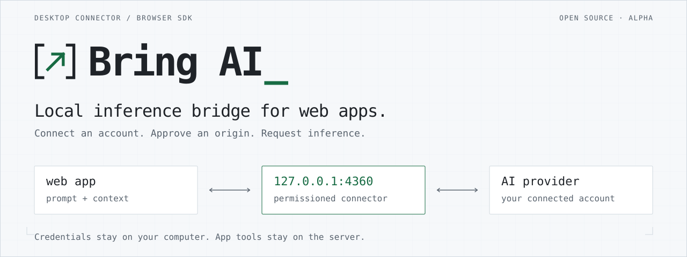
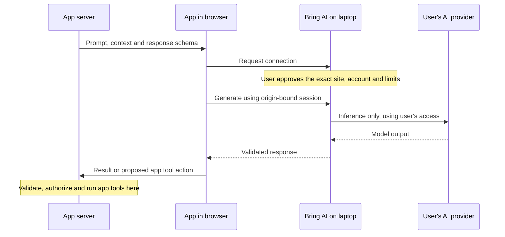
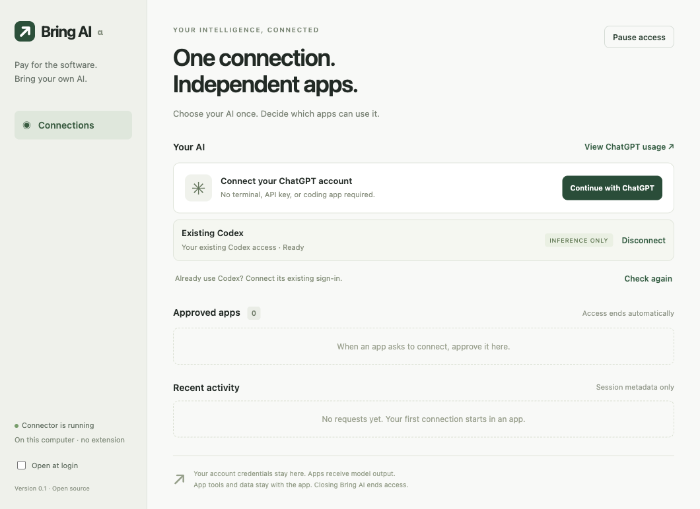

<picture>
  <source media="(prefers-color-scheme: dark)" srcset="docs/brand/banner-dark.svg">
  <source media="(prefers-color-scheme: light)" srcset="docs/brand/banner-light.svg">
  
</picture>

<p align="center">
  <a href="#run-from-source">Get started</a> ·
  <a href="#add-it-to-an-app">Browser SDK</a> ·
  <a href="docs/protocol.md">Protocol</a> ·
  <a href="SECURITY.md">Security</a> ·
  <a href="CONTRIBUTING.md">Contributing</a>
</p>

Bring AI connects web applications to a user's AI account through a local, permissioned service. It includes a desktop connection manager and a dependency-free browser SDK. App backends retain their tools, state and agent loops.

**Alpha:** existing Codex is verified on macOS. Direct ChatGPT sign-in is experimental. [Tested behavior and limitations](docs/validation.md).

## How it connects





## Try the desktop app

Local macOS Apple Silicon builds are in `dist/`. Open `dist/mac-arm64/Bring AI.app`. This is an **unsigned development build**, not a notarized public release. Normal installers do not require Node, npm, a terminal or Codex; developers building the source need Node 22+.

1. Open Bring AI and choose **Continue with ChatGPT**, or **Use existing Codex** if an authenticated Codex installation is detected.
2. In a participating app, choose **Connect my AI**. Allow the browser's local-network permission if requested.
3. Compare the six-digit code and exact site origin in Bring AI. Select the connection, duration and request allowance, then allow the app.
4. Revoke an app or pause all access in Bring AI at any time. Closing the desktop app ends every app session.

**Verified route:** existing Codex on macOS, with real inference through the browser SDK. **Experimental route:** direct ChatGPT OAuth and Responses inference, implemented from the documented OSS/local flow and tested with synthetic OAuth/inference fixtures; a fresh live sign-in still needs user verification. This connector is not a promise of support for every subscription or third-party hosted app. Claude and local-model adapters are not implemented in this version.

The model runs at the provider when using Codex or ChatGPT; the credentials and connection manager live on your laptop. This does not mean the model runs offline on the laptop.

## Run from source

```sh
npm ci
npm start
```

Run examples in separate terminals, then open the printed URLs:

```sh
npm run demo                         # Daylight meal journal, port 4361
node scripts/demo-server.mjs --notes # Margin notes, port 4362
```

Bring AI uses `127.0.0.1:4360`. It never binds a LAN address. Example servers expose only their own public files and a context endpoint. They are reference consumers, not part of the connector's runtime. The previous Bite prototype is separate.

## Add it to an app

The SDK lives at `packages/browser/`; it has no runtime dependencies and includes TypeScript declarations. It is not published to npm yet. Install from this checkout or copy the module into your build.

```js
import { connectAI } from '@bring-ai/browser';

const ai = await connectAI({
  name: 'My app',
  purpose: 'Summarize the note you choose to submit.',
  requires: ['text'],
  onPairing({ verificationCode, approvalUrl }) {
    // Show the code and an "Open Bring AI" link in your app.
    // The user approves in the trusted desktop window.
  },
});

const result = await ai.generate({
  messages: [{ role: 'user', content: 'Summarize this note…' }],
});
console.log(result.output);
```

For typed JSON, request `structuredOutput` when connecting and pass an `outputSchema` to `generate`. Images use the `image` capability and `{ mime, data }` attachments with base64 bytes. `streaming` is an explicit capability: the Codex adapter returns a complete message; direct Responses supports deltas. `onText` is provisional until the completed receipt arrives.

Applications execute their own tool loops. A schema can describe `{action, arguments}`; the app server validates the result and applies its normal user authorization before doing anything. This version exposes no MCP, shell or tool execution operation.

Use `signal` to cancel, `ai.status(requestId)` to recover a retained result, and `ai.disconnect()` to revoke the app session. Inference is never automatically replayed after a dropped connection. See the [protocol](docs/protocol.md), [security model](SECURITY.md) and [validation record](docs/validation.md).

## Build and contribute

```sh
npm test
npm run build           # macOS DMG and ZIP
npm run build:windows   # Windows NSIS, build on Windows
npm run build:linux     # Linux AppImage, build on Linux
```

Electron bundles the desktop runtime. Provider credentials are encrypted using the OS credential service before an atomic owner-only file write. Linux refuses the plaintext `basic_text` storage backend. App grants and inference results are kept in memory only; retained results expire after two minutes, idle cleanup may add 15 seconds. Request allowances limit admitted calls, not exact token cost or provider quota. Failed admitted requests also consume the allowance.

The first release target is desktop Chrome/Chromium on macOS. Windows/Linux packaging configuration and CI are included but are unverified locally. Firefox, Safari, mobile, background jobs and a signed auto-updater are not claimed. An extension transport can be added if browser compatibility evidence warrants it; it is not required by this implementation.

Apache-2.0. See [CONTRIBUTING.md](CONTRIBUTING.md). Reusable logos, banners and the repository preview are in [docs/brand](docs/brand/README.md). Source and build are local; no public GitHub repository, package or download service has been published.

## Provider references

Accessed 2026-11-08: OpenAI [OSS/local sign-in](https://developers.openai.com/siwc/token-sharing-open-source/sign-in), [session handling](https://developers.openai.com/siwc/token-sharing-open-source/profiles-and-sessions), [Responses usage](https://developers.openai.com/siwc/token-sharing-open-source/models-and-inference), and [preview limits](https://developers.openai.com/siwc/token-sharing-open-source/preview-limitations). OpenAI's [overview](https://developers.openai.com/siwc/token-sharing-open-source) distinguishes eligible OSS/local use from paid/remotely hosted integrations; a neutral bridge does not establish permission for every downstream integration.

Browser behavior: [Chrome Local Network Access](https://developer.chrome.com/blog/local-network-access). Credential storage: [Electron safeStorage](https://www.electronjs.org/docs/latest/api/safe-storage).
